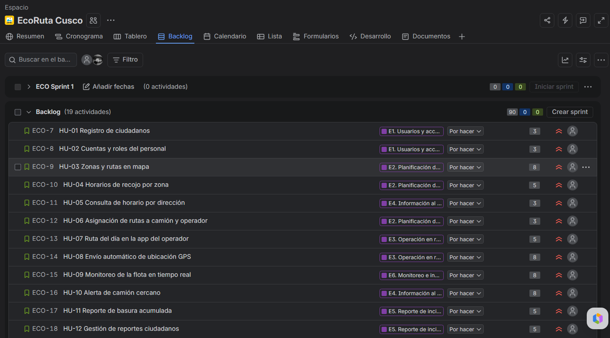
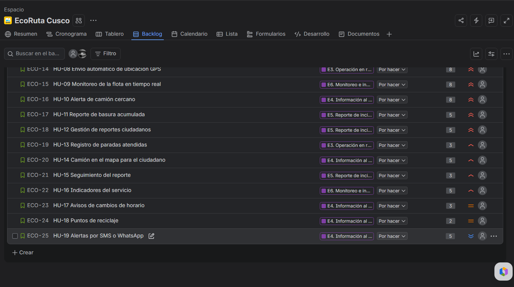

# Laboratorio 3: Elicitación de requerimientos e historias de usuario

**Proyecto:** EcoRuta Cusco: sistema de gestión de recolección de residuos sólidos
**Autora:** Gisel Dayana Farfan Gomez
**Curso:** Ingeniería de Software I

---

## 0. Punto de partida

Los requerimientos se obtuvieron a partir de los artefactos del [Laboratorio 2](lab2-agile-inception.md):

- **Roles de usuario:** salen de la lista de stakeholders (ciudadano, operador de camión, supervisor de limpieza pública, administrador municipal, gerente de limpieza pública y reciclador formalizado).
- **Funcionalidades:** salen del alcance del MVP y de la solución del Lean Canvas.
- **Restricciones y criterios de aceptación:** salen de las mitigaciones de los riesgos iniciales (R1 a R9).

### Roles de usuario

| Rol | Descripción |
|---|---|
| Ciudadano | Vecino del distrito que consulta horarios, recibe alertas y reporta incidencias |
| Operador de camión | Chofer o ayudante que sigue la ruta asignada desde la app móvil |
| Supervisor de limpieza pública | Asigna rutas, monitorea la flota y atiende los reportes ciudadanos |
| Administrador municipal | Configura zonas, rutas, horarios y cuentas del personal |
| Gerente de limpieza pública | Revisa indicadores para tomar decisiones |
| Reciclador formalizado | Consulta puntos y horarios de residuos reciclables |

---

## 1. Identificación de funcionalidades

Las funcionalidades se agruparon en **6 épicas**:

| Épica | Funcionalidades | Origen (Lab 2) | Historias |
|---|---|---|---|
| **E1. Usuarios y acceso** | Registro de ciudadanos; gestión de cuentas y roles del personal | Stakeholders, riesgo R8 | HU-01, HU-02 |
| **E2. Planificación del servicio** | Registro de zonas y rutas en mapa; horarios de recojo; asignación de rutas a camiones y operadores | MVP: "Registro de rutas, zonas y horarios" | HU-03, HU-04, HU-06 |
| **E3. Operación en ruta** | Ruta del día en la app del operador; envío de ubicación GPS; registro de paradas atendidas | MVP: "Seguimiento GPS desde la app del operador" | HU-07, HU-08, HU-13 |
| **E4. Información al ciudadano** | Consulta de horarios; alertas de recolección; camión en el mapa; avisos de cambios; puntos de reciclaje; alertas por SMS | MVP: "Consulta de horarios" y "Notificaciones" | HU-05, HU-10, HU-14, HU-17, HU-18, HU-19 |
| **E5. Reporte de incidencias** | Reporte de basura acumulada con foto y ubicación; gestión de reportes; seguimiento del reporte | MVP: "Reporte ciudadano de basura acumulada" | HU-11, HU-12, HU-15 |
| **E6. Monitoreo e indicadores** | Panel de flota en tiempo real; indicadores del servicio | MVP: "Panel de monitoreo y reportes básicos" | HU-09, HU-16 |

---

## 2. Historias de usuario

Formato: **Como** [usuario] **quiero** [funcionalidad] **para** [beneficio].

| ID | Historia de usuario |
|---|---|
| HU-01 | **Como** ciudadano **quiero** registrarme con mi correo o celular y mi dirección **para** recibir la información de recojo de mi zona. |
| HU-02 | **Como** administrador municipal **quiero** crear cuentas para operadores y supervisores y asignarles un rol **para** que cada uno acceda solo a las funciones que le corresponden. |
| HU-03 | **Como** administrador municipal **quiero** registrar zonas y rutas de recolección sobre un mapa **para** planificar el recorrido de los camiones. |
| HU-04 | **Como** administrador municipal **quiero** definir los días y horarios de recojo de cada zona por tipo de residuo **para** que el servicio sea predecible. |
| HU-05 | **Como** ciudadano **quiero** consultar el horario de recojo escribiendo mi dirección **para** sacar mi basura a tiempo. |
| HU-06 | **Como** supervisor **quiero** asignar cada ruta a un camión y a un operador por día **para** organizar el servicio. |
| HU-07 | **Como** operador de camión **quiero** ver en mi celular la ruta del día con las paradas en orden **para** seguir el recorrido sin perderme. |
| HU-08 | **Como** operador de camión **quiero** que la app envíe mi ubicación automáticamente mientras hago la ruta **para** que la municipalidad y los vecinos sepan dónde está el camión. |
| HU-09 | **Como** supervisor **quiero** ver en un mapa la ubicación en tiempo real de todos los camiones **para** saber si están cumpliendo sus rutas. |
| HU-10 | **Como** ciudadano **quiero** recibir una alerta cuando el camión esté cerca de mi casa **para** sacar mi basura a tiempo. |
| HU-11 | **Como** ciudadano **quiero** reportar un punto de basura acumulada con una foto y su ubicación **para** que la municipalidad lo atienda. |
| HU-12 | **Como** supervisor **quiero** ver los reportes ciudadanos en una lista y en un mapa y cambiar su estado **para** organizar su atención. |
| HU-13 | **Como** operador de camión **quiero** marcar cada parada como atendida o no atendida **para** dejar registro del servicio realizado. |
| HU-14 | **Como** ciudadano **quiero** ver en el mapa dónde está el camión de mi zona **para** saber cuánto falta para que pase. |
| HU-15 | **Como** ciudadano **quiero** ver el estado de mis reportes **para** saber si fueron atendidos. |
| HU-16 | **Como** gerente de limpieza pública **quiero** ver indicadores del servicio por zona y por fecha **para** tomar decisiones sobre rutas y recursos. |
| HU-17 | **Como** administrador municipal **quiero** publicar avisos de cambios temporales de horario **para** que los vecinos se enteren a tiempo. |
| HU-18 | **Como** reciclador formalizado **quiero** consultar los puntos y horarios de recojo de residuos reciclables **para** organizar mi recorrido. |
| HU-19 | **Como** ciudadano sin smartphone **quiero** recibir las alertas por SMS o WhatsApp **para** no quedar fuera del servicio. |

### Verificación de calidad (INVEST)

Cada historia se revisó con el criterio **INVEST**:

| Criterio | Cómo se aplicó |
|---|---|
| **I**ndependiente | Cada historia entrega una funcionalidad completa. Las dependencias se resolvieron con el orden del backlog (por ejemplo, HU-03 va antes que HU-04) |
| **N**egociable | Las historias dicen *qué* se necesita, no *cómo* implementarlo (no fijan tecnología ni pantallas) |
| **V**aliosa | Todas tienen un "para" con un beneficio concreto para un rol real |
| **E**stimable | Todas tienen story points asignados |
| **S**mall (pequeña) | Ninguna supera 8 puntos, así que cada una cabe en un sprint |
| **T**esteable | Todas tienen criterios de aceptación verificables (sección 4) |

---

## 3. Priorización: Product Backlog inicial

### Criterios usados

- **MoSCoW:**
  - **Must:** sin esto el MVP no funciona.
  - **Should:** importante, pero el MVP funciona sin ello.
  - **Could:** deseable si hay tiempo.
  - **Won't:** fuera de esta versión.
- **Story points (SP):** escala de Fibonacci (1, 2, 3, 5, 8). Mide el esfuerzo relativo, no horas.
- **Orden dentro de cada prioridad:**
  1. Dependencias: primero los datos base (usuarios, zonas, rutas).
  2. Valor para el objetivo principal del Lab 2: "que la basura se recoja a tiempo".
  3. Riesgo: lo más incierto técnicamente (GPS) se aborda temprano.

### Backlog ordenado

| Orden | ID | Historia (resumen) | Épica | Rol | Prioridad | SP |
|---|---|---|---|---|---|---|
| 1 | HU-01 | Registro de ciudadanos | E1 | Ciudadano | Must | 3 |
| 2 | HU-02 | Cuentas y roles del personal | E1 | Administrador | Must | 3 |
| 3 | HU-03 | Zonas y rutas en mapa | E2 | Administrador | Must | 8 |
| 4 | HU-04 | Horarios de recojo por zona | E2 | Administrador | Must | 5 |
| 5 | HU-05 | Consulta de horario por dirección | E4 | Ciudadano | Must | 3 |
| 6 | HU-06 | Asignación de rutas a camión y operador | E2 | Supervisor | Must | 3 |
| 7 | HU-07 | Ruta del día en la app del operador | E3 | Operador | Must | 5 |
| 8 | HU-08 | Envío automático de ubicación GPS | E3 | Operador | Must | 8 |
| 9 | HU-09 | Monitoreo de la flota en tiempo real | E6 | Supervisor | Must | 8 |
| 10 | HU-10 | Alerta de camión cercano | E4 | Ciudadano | Must | 8 |
| 11 | HU-11 | Reporte de basura acumulada | E5 | Ciudadano | Must | 5 |
| 12 | HU-12 | Gestión de reportes ciudadanos | E5 | Supervisor | Must | 5 |
| 13 | HU-13 | Registro de paradas atendidas | E3 | Operador | Should | 3 |
| 14 | HU-14 | Camión en el mapa para el ciudadano | E4 | Ciudadano | Should | 5 |
| 15 | HU-15 | Seguimiento del reporte | E5 | Ciudadano | Should | 3 |
| 16 | HU-16 | Indicadores del servicio | E6 | Gerente | Should | 5 |
| 17 | HU-17 | Avisos de cambios de horario | E4 | Administrador | Could | 3 |
| 18 | HU-18 | Puntos de reciclaje | E4 | Reciclador | Could | 2 |
| 19 | HU-19 | Alertas por SMS o WhatsApp | E4 | Ciudadano | Won't | 5 |

### Resumen

| Prioridad | Historias | Story points |
|---|---|---|
| Must | 12 | 64 |
| Should | 4 | 16 |
| Could | 2 | 5 |
| Won't (esta versión) | 1 | 5 |
| **Total** | **19** | **90** |

- **Primera versión (MVP):** las 12 historias *Must* (HU-01 a HU-12). Con ellas se cumple el ciclo completo: la municipalidad planifica, el camión transmite su ubicación, el ciudadano recibe la alerta y puede reportar incidencias.
- **HU-19 queda como *Won't*:** el envío de SMS tiene un costo por mensaje que hoy no está presupuestado. Se mantiene en el backlog porque es la mitigación del riesgo R1 (baja adopción) y se retomará si la adopción por la app es baja.

---

## 4. Trabajo extra: criterios de aceptación

Formato: **Dado** [contexto] **cuando** [acción] **entonces** [resultado esperado].

### HU-01: Registro de ciudadanos
1. **Dado** que ingreso nombre, correo o celular, contraseña y dirección válidos, **cuando** confirmo el registro, **entonces** se crea mi cuenta y el sistema me asigna la zona de mi dirección.
2. **Dado** que el correo o celular ya está registrado, **cuando** intento registrarme, **entonces** el sistema me lo indica y me ofrece iniciar sesión.
3. **Dado** que mi dirección no tiene numeración, **cuando** la registro, **entonces** puedo marcar mi vivienda directamente en el mapa.
4. **Dado** que no acepto la política de privacidad, **cuando** intento registrarme, **entonces** no se crea la cuenta. Solo se piden los datos mínimos (Ley 29733, riesgo R8).

### HU-02: Cuentas y roles del personal
1. **Dado** que creo una cuenta con rol "operador", **cuando** esa persona inicia sesión, **entonces** solo ve la app de ruta, no el panel municipal.
2. **Dado** que desactivo una cuenta, **cuando** el usuario intenta iniciar sesión, **entonces** el acceso es denegado.
3. **Dado** que soy ciudadano, **cuando** intento entrar al panel municipal, **entonces** el sistema me lo impide.

### HU-03: Zonas y rutas en mapa
1. **Dado** que dibujo el área de una zona en el mapa, **cuando** la guardo con un nombre, **entonces** queda disponible para asignarle horarios y rutas.
2. **Dado** que creo una ruta, **cuando** agrego sus paradas en orden, **entonces** el mapa muestra el recorrido y su distancia aproximada.
3. **Dado** que una nueva zona se superpone con otra existente, **cuando** intento guardarla, **entonces** el sistema me advierte (riesgo R6).

### HU-04: Horarios de recojo por zona
1. **Dado** que selecciono una zona, **cuando** registro días, rango horario y tipo de residuo (general o reciclable), **entonces** el horario queda visible para los ciudadanos de esa zona.
2. **Dado** que la hora de fin es anterior a la de inicio, **cuando** intento guardar, **entonces** el sistema no lo permite.
3. **Dado** que modifico un horario, **cuando** guardo el cambio, **entonces** la consulta de horarios muestra el nuevo valor de inmediato.

### HU-05: Consulta de horario por dirección
1. **Dado** que mi dirección está dentro de una zona registrada, **cuando** la busco, **entonces** veo los días, el rango horario y el tipo de residuo.
2. **Dado** que mi dirección está fuera de las zonas registradas, **cuando** la busco, **entonces** el sistema muestra "zona sin horario registrado".
3. **Dado** que no tengo cuenta, **cuando** entro a la web, **entonces** igual puedo consultar el horario (sin iniciar sesión).

### HU-06: Asignación de rutas a camión y operador
1. **Dado** que la ruta, el camión y el operador están disponibles, **cuando** hago la asignación para una fecha, **entonces** la ruta aparece en la app del operador ese día.
2. **Dado** que el camión ya tiene otra ruta en el mismo horario, **cuando** intento asignarlo, **entonces** el sistema impide la asignación.
3. **Dado** que reasigno una ruta a otro operador, **cuando** guardo el cambio, **entonces** el operador anterior deja de verla y el nuevo la recibe.

### HU-07: Ruta del día en la app del operador
1. **Dado** que tengo una ruta asignada, **cuando** abro la app, **entonces** veo el mapa del recorrido y la lista de paradas en orden, en no más de dos toques (riesgo R3).
2. **Dado** que no tengo conexión, **cuando** abro la app, **entonces** veo la ruta que se descargó previamente (riesgo R4).
3. **Dado** que no tengo ruta asignada, **cuando** abro la app, **entonces** veo el mensaje "No tienes rutas asignadas para hoy".

### HU-08: Envío automático de ubicación GPS
1. **Dado** que inicié la ruta, **cuando** el camión está en movimiento, **entonces** la app envía la ubicación cada 30 segundos sin que yo haga nada.
2. **Dado** que pierdo la señal, **cuando** recupero la conexión, **entonces** las ubicaciones guardadas se sincronizan en orden (riesgos R2 y R4).
3. **Dado** que finalizo la ruta, **cuando** confirmo el fin, **entonces** la app deja de enviar la ubicación.

### HU-09: Monitoreo de la flota en tiempo real
1. **Dado** que hay camiones en ruta, **cuando** abro el panel, **entonces** veo cada camión en el mapa con su ruta, su operador y su porcentaje de avance.
2. **Dado** que un camión no envía ubicación por más de 5 minutos, **cuando** reviso el panel, **entonces** aparece como "sin señal" con su última ubicación conocida y la hora (riesgo R2).
3. **Dado** que el panel está abierto, **cuando** llegan nuevas ubicaciones, **entonces** el mapa se actualiza al menos una vez por minuto sin recargar la página.

### HU-10: Alerta de camión cercano
1. **Dado** que tengo las alertas activadas, **cuando** el camión de mi zona está a 10 minutos de mi dirección, **entonces** recibo una notificación en el celular.
2. **Dado** que quiero más o menos anticipación, **cuando** entro a configuración, **entonces** puedo elegir 5, 10 o 15 minutos, o desactivar las alertas.
3. **Dado** que el camión pasa varias veces cerca de mi casa en el mismo recorrido, **cuando** se generan las alertas, **entonces** recibo una sola notificación.

### HU-11: Reporte de basura acumulada
1. **Dado** que adjunto una foto y la ubicación (GPS o marcada en el mapa), **cuando** envío el reporte, **entonces** queda registrado como "Pendiente" y recibo un número de seguimiento.
2. **Dado** que no adjunto foto o ubicación, **cuando** intento enviar, **entonces** el sistema no lo permite (riesgo R7).
3. **Dado** que ya envié 5 reportes en el día, **cuando** intento enviar otro, **entonces** el sistema me indica que alcancé el límite diario (riesgo R7).

### HU-12: Gestión de reportes ciudadanos
1. **Dado** que hay reportes nuevos, **cuando** abro la bandeja, **entonces** veo la foto, la ubicación, la fecha y el estado de cada uno, ordenados del más antiguo al más reciente.
2. **Dado** que cambio el estado de un reporte (Pendiente → En atención → Atendido), **cuando** guardo, **entonces** quedan registrados la fecha y el responsable del cambio.
3. **Dado** que rechazo un reporte, **cuando** guardo, **entonces** el sistema me obliga a indicar el motivo.

### HU-13: Registro de paradas atendidas
1. **Dado** que llego a una parada, **cuando** la marco como atendida, **entonces** se registran la hora y la ubicación.
2. **Dado** que no pude atender una parada, **cuando** la marco como no atendida, **entonces** debo elegir un motivo (calle bloqueada, camión lleno u otro) y el supervisor lo ve en el panel.
3. **Dado** que no tengo conexión, **cuando** marco una parada, **entonces** el registro se guarda y se envía al recuperar la señal.

### HU-14: Camión en el mapa para el ciudadano
1. **Dado** que el camión de mi zona está en ruta, **cuando** abro el mapa, **entonces** veo su posición y el tiempo estimado de llegada a mi dirección.
2. **Dado** que no hay un camión en ruta en mi zona, **cuando** abro el mapa, **entonces** veo la fecha y hora del próximo recojo.
3. **Dado** que el camión perdió la señal, **cuando** abro el mapa, **entonces** veo su "última ubicación conocida" con la hora.

### HU-15: Seguimiento del reporte
1. **Dado** que envié reportes, **cuando** abro "Mis reportes", **entonces** veo cada uno con su estado y la fecha del último cambio.
2. **Dado** que mi reporte pasa a "Atendido", **cuando** el supervisor guarda el cambio, **entonces** recibo una notificación.
3. **Dado** que mi reporte es rechazado, **cuando** recibo la notificación, **entonces** veo el motivo del rechazo.

### HU-16: Indicadores del servicio
1. **Dado** que elijo un rango de fechas, **cuando** abro los indicadores, **entonces** veo el porcentaje de rutas completadas a tiempo, los reportes recibidos vs. atendidos y el tiempo promedio de atención.
2. **Dado** que selecciono una zona, **cuando** aplico el filtro, **entonces** los indicadores se recalculan solo para esa zona.
3. **Dado** que necesito presentar los resultados, **cuando** pulso "Exportar", **entonces** descargo los indicadores en Excel o PDF.

### HU-17: Avisos de cambios de horario
1. **Dado** que creo un aviso para ciertas zonas y fechas, **cuando** lo publico, **entonces** los ciudadanos de esas zonas reciben una notificación.
2. **Dado** que hay un aviso vigente, **cuando** un ciudadano consulta su horario, **entonces** ve el aviso junto al horario.
3. **Dado** que pasó la fecha final del aviso, **cuando** se consulta el horario, **entonces** el aviso ya no se muestra.

### HU-18: Puntos de reciclaje
1. **Dado** que entro a la sección de reciclaje, **cuando** se carga el mapa, **entonces** veo los puntos de acopio con sus días y horarios.
2. **Dado** que selecciono una zona, **cuando** aplico el filtro, **entonces** solo veo los puntos de esa zona.

### HU-19: Alertas por SMS o WhatsApp (Won't en esta versión)
1. **Dado** que registré mi celular y elegí SMS como canal, **cuando** el camión se acerca, **entonces** recibo la alerta por SMS.
2. **Dado** que no tengo la app instalada, **cuando** me registro por la web, **entonces** puedo elegir SMS o WhatsApp como canal de alertas.

---

## 5. Product Backlog en Jira

El Product Backlog se registró en **Jira**, en el espacio Scrum **EcoRuta Cusco (ECO)**:
[ver backlog en Jira](https://ing-software1-residuos.atlassian.net/jira/software/projects/ECO/boards/2/backlog).

- **Épicas:** E1 a E6 (ECO-1 a ECO-6).
- **Historias:** HU-01 a HU-19 (ECO-7 a ECO-25), cada una con:
  - la historia y sus criterios de aceptación en la descripción;
  - su épica, sus story points y su prioridad;
  - etiquetas con la prioridad MoSCoW y el rol de usuario.
- **Prioridad en Jira:** se asignó según MoSCoW:

  | MoSCoW | Prioridad en Jira |
  |---|---|
  | Must | Highest |
  | Should | High |
  | Could | Medium |
  | Won't | Lowest |

- **Orden del backlog:** el mismo de la sección 3. Las historias quedan listas para planificar el primer sprint.

El backlog también se exportó en [`backlog/product-backlog-jira.csv`](backlog/product-backlog-jira.csv), que puede importarse en Jira desde *Importar incidencias desde CSV*.

