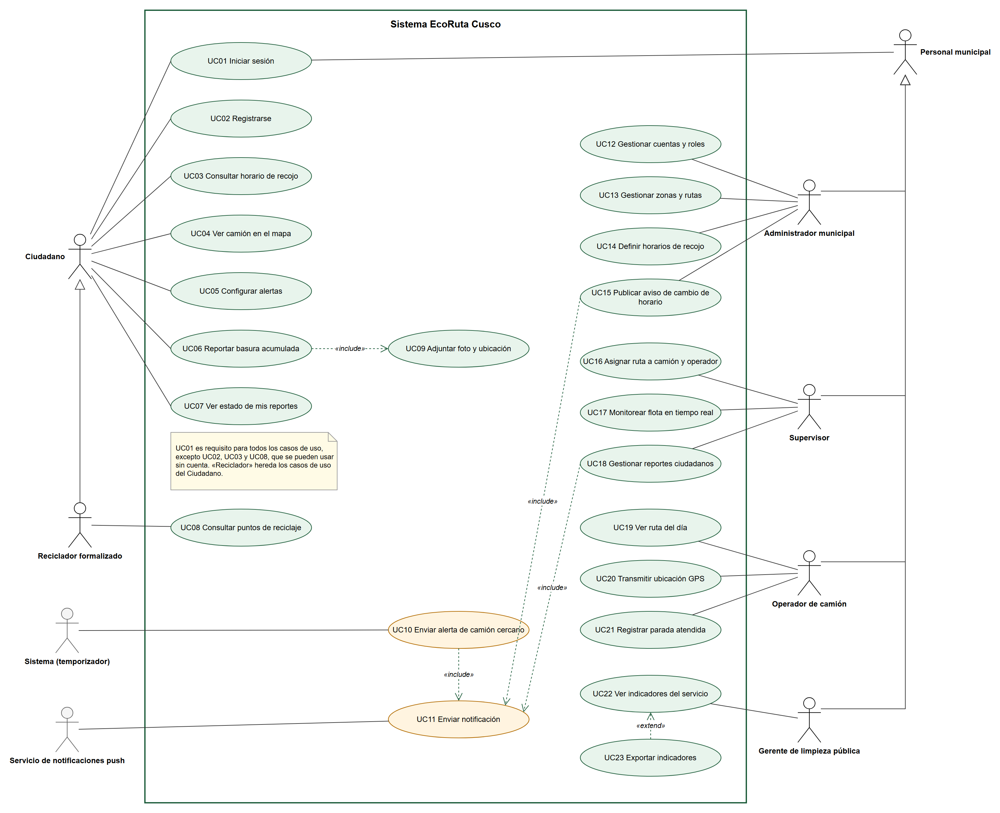
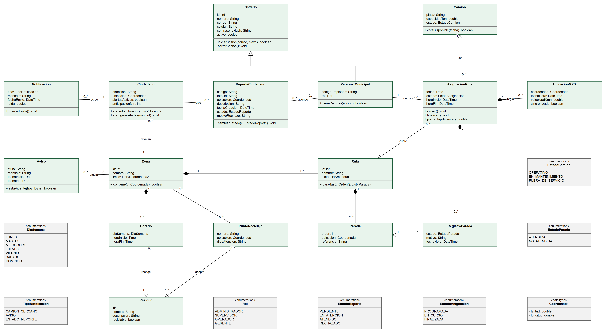
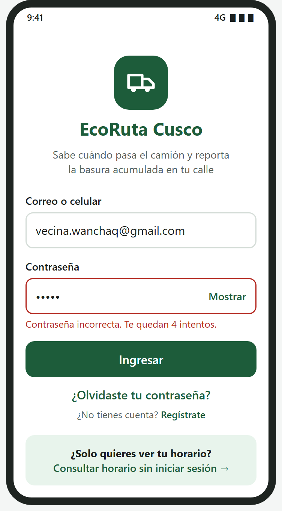
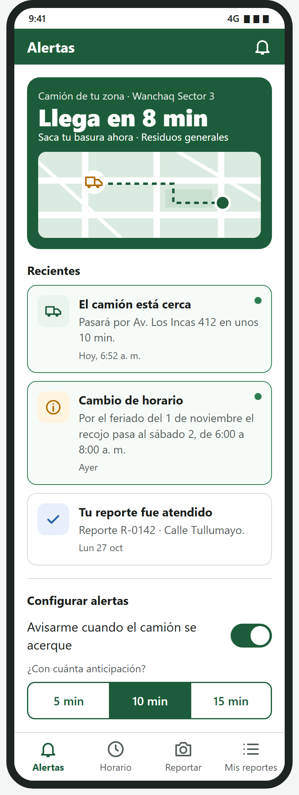
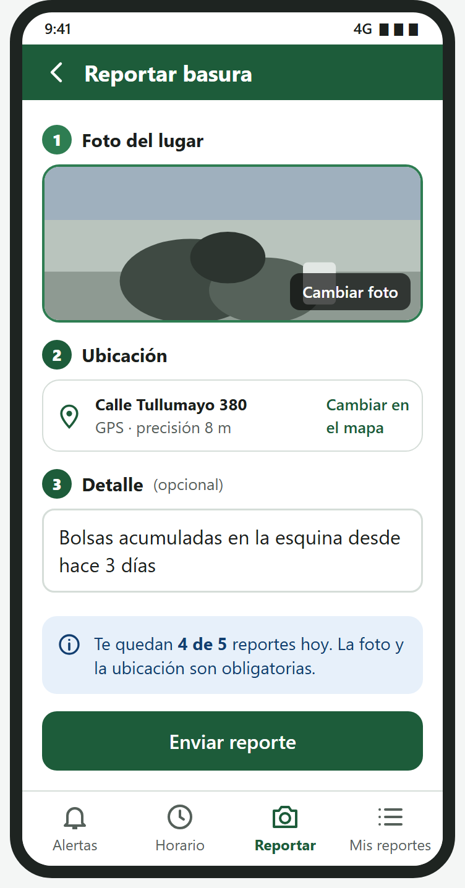
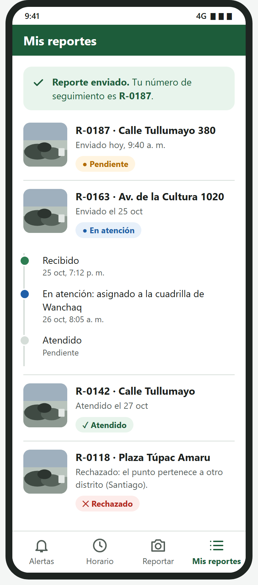
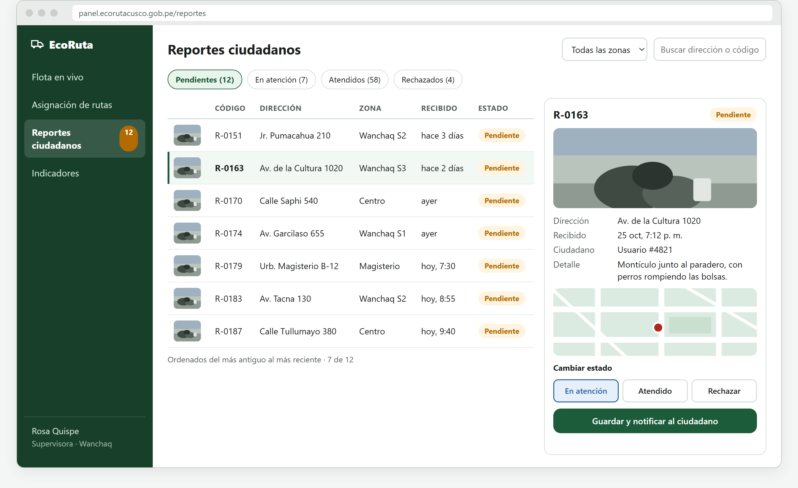
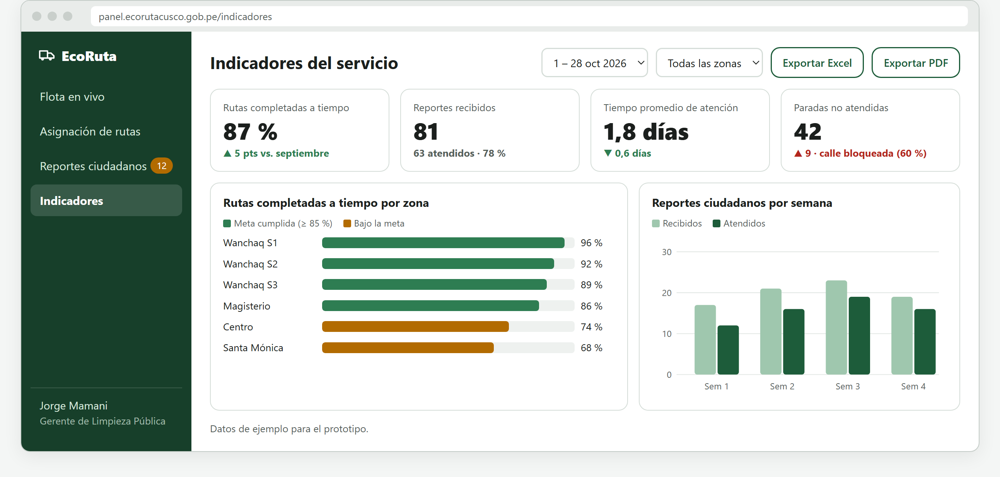

# Laboratorio 4: Modelado del sistema: UML y prototipos

**Proyecto:** EcoRuta Cusco: sistema de gestión de recolección de residuos sólidos
**Autora:** Gisel Dayana Farfan Gomez
**Curso:** Ingeniería de Software I

---

## 0. Punto de partida

Los modelos se construyeron a partir de las historias de usuario del [Laboratorio 3](lab3-historias-usuario.md):

- **Actores:** salen de los roles de usuario (ciudadano, operador, supervisor, administrador, gerente y reciclador).
- **Casos de uso:** cada historia HU-01 a HU-18 se convirtió en uno o más casos de uso. HU-19 (SMS/WhatsApp) quedó fuera porque es *Won't* en esta versión.
- **Clases:** salen de los sustantivos de las historias y de sus criterios de aceptación (zona, ruta, parada, camión, reporte, horario, etc.).
- **Pantallas del prototipo:** salen de las historias *Must* y *Should* que tocan el login, las alertas y los reportes.

Herramientas usadas:

| Parte | Herramienta | Archivo |
|---|---|---|
| Diagrama de casos de uso | Draw.io | [diagramas/lab4-casos-de-uso.drawio](diagramas/lab4-casos-de-uso.drawio) |
| Diagrama de clases | Draw.io | [diagramas/lab4-clases.drawio](diagramas/lab4-clases.drawio) |
| Prototipo | HTML/CSS (maqueta navegable) | [prototipo/index.html](prototipo/index.html) |

---

## 1. Diagrama de casos de uso

### 1.1 Actores

El laboratorio pide tres actores: **Ciudadano**, **Administrador** y **Sistema**. Para que el diagrama sea coherente con los roles del Lab 3 se hicieron dos ajustes:

| Actor del laboratorio | Cómo se modeló | Por qué |
|---|---|---|
| Ciudadano | **Ciudadano** (actor principal) y **Reciclador formalizado**, que hereda de Ciudadano | El reciclador usa todo lo del ciudadano y además consulta puntos de reciclaje (HU-18) |
| Administrador | **Personal municipal** (actor general) con cuatro especializaciones: **Administrador municipal**, **Supervisor**, **Operador de camión** y **Gerente de limpieza pública** | En el Lab 3 cada rol tiene funciones distintas (HU-02 pide que cada uno acceda solo a lo suyo). La generalización evita repetir "Iniciar sesión" en cada uno |
| Sistema | **Sistema (temporizador)** y **Servicio de notificaciones push** como actores secundarios, fuera del límite del sistema | En UML el sistema es el rectángulo, no un actor. Lo que sí actúa "desde fuera" es el reloj que dispara las alertas automáticas y el servicio externo que entrega las notificaciones al celular |

### 1.2 Casos de uso

| ID | Caso de uso | Actor | Historia |
|---|---|---|---|
| UC01 | Iniciar sesión | Ciudadano, Personal municipal | HU-01, HU-02 |
| UC02 | Registrarse | Ciudadano | HU-01 |
| UC03 | Consultar horario de recojo | Ciudadano | HU-05 |
| UC04 | Ver camión en el mapa | Ciudadano | HU-14 |
| UC05 | Configurar alertas | Ciudadano | HU-10 |
| UC06 | Reportar basura acumulada | Ciudadano | HU-11 |
| UC07 | Ver estado de mis reportes | Ciudadano | HU-15 |
| UC08 | Consultar puntos de reciclaje | Reciclador formalizado | HU-18 |
| UC09 | Adjuntar foto y ubicación | (incluido por UC06) | HU-11 |
| UC10 | Enviar alerta de camión cercano | Sistema (temporizador) | HU-10 |
| UC11 | Enviar notificación | Servicio de notificaciones push | HU-10, HU-15, HU-17 |
| UC12 | Gestionar cuentas y roles | Administrador municipal | HU-02 |
| UC13 | Gestionar zonas y rutas | Administrador municipal | HU-03 |
| UC14 | Definir horarios de recojo | Administrador municipal | HU-04 |
| UC15 | Publicar aviso de cambio de horario | Administrador municipal | HU-17 |
| UC16 | Asignar ruta a camión y operador | Supervisor | HU-06 |
| UC17 | Monitorear flota en tiempo real | Supervisor | HU-09 |
| UC18 | Gestionar reportes ciudadanos | Supervisor | HU-12 |
| UC19 | Ver ruta del día | Operador de camión | HU-07 |
| UC20 | Transmitir ubicación GPS | Operador de camión | HU-08 |
| UC21 | Registrar parada atendida | Operador de camión | HU-13 |
| UC22 | Ver indicadores del servicio | Gerente de limpieza pública | HU-16 |
| UC23 | Exportar indicadores | (extiende UC22) | HU-16 |

### 1.3 Relaciones

- **«include»**
  - UC06 → UC09: no se puede enviar un reporte sin foto y ubicación (criterio 2 de HU-11, riesgo R7).
  - UC10, UC15 y UC18 → UC11: la alerta del camión, el aviso de cambio de horario y el cambio de estado de un reporte terminan siempre en una notificación al ciudadano.
- **«extend»**
  - UC23 → UC22: exportar es opcional. El gerente puede ver los indicadores sin exportarlos.
- **Generalización de actores**
  - Reciclador → Ciudadano.
  - Administrador, Supervisor, Operador y Gerente → Personal municipal.
- **UC01 como requisito:** todos los casos de uso necesitan sesión, excepto UC02, UC03 y UC08. Así se cumple el criterio 3 de HU-05: la consulta de horario se puede hacer sin cuenta. Esto se indica con una nota en el diagrama en lugar de dibujar un «include» desde cada caso de uso, para no saturarlo de líneas.

---

## 2. Diagrama de clases

### 2.1 Clases

El laboratorio da como ejemplo **Usuario**, **Residuo**, **Ruta** y **Camión**. Las cuatro están en el modelo y se completaron con las clases que piden las historias del Lab 3:

| Clase | Responsabilidad | Historias |
|---|---|---|
| **Usuario** *(abstracta)* | Datos de acceso comunes a todos: correo o celular, contraseña cifrada, estado activo | HU-01, HU-02 |
| Ciudadano | Dirección, ubicación y preferencias de alerta (activas y minutos de anticipación) | HU-01, HU-05, HU-10 |
| PersonalMunicipal | Empleado con un **Rol** que define qué puede hacer | HU-02 |
| Zona | Área de la ciudad delimitada en el mapa. Sabe si una coordenada está dentro | HU-03, HU-05 |
| Horario | Día y rango horario de recojo de una zona para un tipo de residuo | HU-04 |
| **Residuo** | Catálogo de tipos de residuo (general, orgánico, plástico, papel...) y si es reciclable | HU-04, HU-18 |
| **Ruta** | Recorrido planificado dentro de una zona | HU-03 |
| Parada | Punto de una ruta, con su orden | HU-03, HU-07 |
| **Camion** | Vehículo de la flota y su estado | HU-06 |
| AsignacionRuta | Une una ruta, un camión y un operador en una fecha. Guarda el avance del recorrido | HU-06, HU-07, HU-09 |
| UbicacionGPS | Posición enviada por la app durante una asignación. Marca si ya se sincronizó (modo offline) | HU-08, HU-14 |
| RegistroParada | Parada atendida o no atendida, con motivo y hora | HU-13 |
| ReporteCiudadano | Reporte de basura acumulada con foto, ubicación, estado y motivo de rechazo | HU-11, HU-12, HU-15 |
| Notificacion | Mensaje enviado a un ciudadano (camión cercano, aviso o estado de reporte) | HU-10, HU-15, HU-17 |
| Aviso | Cambio temporal de horario para una o más zonas, con fecha de vigencia | HU-17 |
| PuntoReciclaje | Punto de acopio de reciclables con sus días de atención | HU-18 |

Además hay un tipo de dato y varias enumeraciones:

- **Tipo de dato:** `Coordenada` (latitud y longitud).
- **Enumeraciones:** `Rol`, `EstadoReporte`, `EstadoAsignacion`, `EstadoParada`, `EstadoCamion`, `TipoNotificacion` y `DiaSemana`.

### 2.2 Decisiones de diseño

- **Herencia en Usuario:** el ciudadano y el personal comparten login, pero tienen datos y permisos distintos. Usuario es abstracta porque nunca existe un usuario "genérico".
- **AsignacionRuta como clase propia:** la relación entre ruta, camión y operador cambia cada día (HU-06). Por eso no es una asociación directa entre Ruta y Camion. La asignación es la que acumula las ubicaciones GPS y los registros de parada de ese recorrido.
- **Composición (rombo negro)** donde la parte no tiene sentido sin el todo:
  - Zona ◆ Horario y Zona ◆ Ruta.
  - Ruta ◆ Parada (mínimo 2 paradas).
  - AsignacionRuta ◆ UbicacionGPS y AsignacionRuta ◆ RegistroParada.
- **Residuo como catálogo:** el sistema no rastrea cada bolsa de basura. Lo que importa es *qué tipo* de residuo se recoge en cada horario y qué acepta cada punto de reciclaje.
- **Asociaciones con flecha (navegables)** cuando solo un lado necesita conocer al otro. Por ejemplo, un Horario sabe qué Residuo recoge, pero el Residuo no necesita conocer sus horarios.
- **Datos personales mínimos (riesgo R8):** el ciudadano guarda solo correo o celular, contraseña cifrada (`contrasenaHash`) y dirección. En el reporte, el supervisor ve un identificador y no los datos personales.

---

## 3. Prototipo

El prototipo es una **maqueta navegable en HTML/CSS** ([prototipo/index.html](prototipo/index.html)). Se abre con doble clic en cualquier navegador:

- Sin nada después de la dirección se ven todas las pantallas juntas, como *storyboard*.
- Con `#login`, `#alertas`, `#reportar`, etc. se ve una sola pantalla.
- Los botones y las pestañas inferiores llevan a la pantalla siguiente.

Se eligió HTML en lugar de Figma para que el prototipo quede versionado en el repositorio junto con el resto de la documentación. Si se necesita en Figma, la página se puede importar con un plugin que convierte HTML en capas de Figma (por ejemplo, *html.to.design*).

"Reportes" tiene dos significados en el proyecto, así que se diseñaron los dos:
- el **reporte ciudadano** de basura acumulada (app móvil);
- los **reportes del servicio** para la municipalidad (panel web).

Los datos que aparecen en las pantallas son de ejemplo.

### 3.1 Login (HU-01, HU-02, HU-05)

- Un solo campo para **correo o celular**, como en HU-01.
- El error se muestra debajo del campo, en rojo, e indica cuántos intentos quedan.
- Botón **Mostrar** contraseña, para no escribirla a ciegas en el celular.
- **Consultar horario sin iniciar sesión** en un recuadro visible (criterio 3 de HU-05). Así quien no quiere crear una cuenta igual obtiene valor (riesgo R1).
- La misma pantalla sirve para el personal municipal: según el rol (HU-02), después del login se abre la app del operador o el panel web.

### 3.2 Alertas (HU-10, HU-14, HU-17)

- **Tarjeta principal** con el tiempo estimado de llegada del camión, en letra grande, y el mapa con su posición (HU-14).
- **Lista de notificaciones** recientes con ícono y color por tipo: camión cercano, cambio de horario (HU-17) y reporte atendido (HU-15). Las no leídas tienen un punto verde.
- **Configurar alertas** en la misma pantalla: activar o desactivar, y elegir 5, 10 o 15 minutos de anticipación (criterio 2 de HU-10).

### 3.3 Reportes

#### a) Reportar basura acumulada · ciudadano (HU-11)

- El formulario está dividido en **3 pasos numerados**: foto, ubicación y detalle. El detalle es opcional y se marca como tal.
- La ubicación se toma del GPS y se puede **cambiar en el mapa** si no es exacta.
- Un aviso informa cuántos reportes quedan en el día (**4 de 5**) y recuerda que la foto y la ubicación son obligatorias (riesgo R7).

#### b) Mis reportes · ciudadano (HU-15)

- Al enviar se confirma con el **número de seguimiento** (criterio 1 de HU-11).
- Cada reporte muestra su estado con color y texto: Pendiente, En atención, Atendido y Rechazado. No depende solo del color.
- La línea de tiempo muestra cada cambio con su fecha. Los rechazados muestran el motivo (criterio 3 de HU-15).

#### c) Gestión de reportes ciudadanos · supervisor (HU-12)

- Bandeja ordenada **del más antiguo al más reciente**, con contadores por estado (criterio 1 de HU-12).
- Al seleccionar un reporte se abre el detalle a la derecha, con foto, datos y mapa.
- Para cambiar el estado basta un clic, y el botón deja claro que **se notificará al ciudadano** (UC18 incluye UC11).

#### d) Indicadores del servicio · gerente (HU-16)

- Filtros por **rango de fechas** y por **zona**, y exportación a **Excel y PDF** (criterios 1 a 3 de HU-16, UC23).
- Cuatro indicadores clave, cada uno con su variación respecto al período anterior.
- Las zonas que están **bajo la meta** se resaltan con otro color, para ver de inmediato dónde actuar.

---

## 4. Trabajo extra

### 4.1 Mejoras de diseño UX

Las pantallas se revisaron con las **10 heurísticas de usabilidad de Nielsen** y con pautas básicas de accesibilidad. Estas son las decisiones que salieron de esa revisión:

| Mejora aplicada | Heurística / pauta | Riesgo o historia que atiende |
|---|---|---|
| Botones y campos de **48 px de alto** como mínimo y texto base de 16 px | Accesibilidad (tamaño táctil) | R1: usuarios mayores o con poca experiencia digital |
| Estados con **color + texto + ícono** (✓ Atendido, ✕ Rechazado) | Accesibilidad (no depender solo del color) | HU-12, HU-15 |
| El tiempo de llegada del camión es lo primero que se ve en Alertas | Visibilidad del estado del sistema | HU-10, HU-14 |
| Errores **junto al campo** y en lenguaje simple ("Contraseña incorrecta. Te quedan 4 intentos") | Ayudar a reconocer y recuperarse de errores | HU-01 |
| Aviso del límite diario **antes** de enviar el reporte | Prevención de errores | R7, HU-11 |
| Confirmación con número de seguimiento al enviar | Visibilidad del estado del sistema | HU-11 |
| Consultar horario sin cuenta | Flexibilidad y eficiencia de uso | R1, HU-05 |
| Formulario de reporte en 3 pasos numerados | Reconocer antes que recordar | HU-11 |
| Barra inferior con 4 secciones fijas, siempre en el mismo lugar | Consistencia y estándares | Toda la app móvil |
| Vocabulario del vecino ("Saca tu basura ahora", "camión de tu zona") en lugar de términos técnicos | Relación entre el sistema y el mundo real | R1 |
| Paleta verde institucional con contraste alto entre texto y fondo | Diseño estético y minimalista / contraste WCAG | Todas |

**Mejoras pendientes** para la siguiente versión del prototipo:

- Pantalla del **operador de camión** (HU-07, HU-13), con botones aún más grandes para usarla dentro de la cabina (riesgo R3).
- Indicador visible de **"sin conexión"** y de datos pendientes de sincronizar (riesgo R4).
- Versión en **quechua** de los textos principales de la app ciudadana.

### 4.2 Validación con usuarios

La validación se planificó como una **prueba de usabilidad moderada** con el prototipo navegable. Los resultados se registrarán en la tabla de la sección 4.2.4 cuando se realicen las sesiones.

#### 4.2.1 Participantes

| Perfil | Cantidad | Pantallas que evalúa |
|---|---|---|
| Ciudadanos (al menos 2 mayores de 50 años) | 5 | Login, Alertas, Reportar, Mis reportes |
| Personal de limpieza pública (supervisor o administrativo) | 2 | Panel de reportes, Indicadores |

Cinco usuarios por perfil suelen bastar para encontrar la mayoría de los problemas de usabilidad (Nielsen, 2000).

#### 4.2.2 Tareas

| # | Tarea que se le pide al participante | Éxito si... |
|---|---|---|
| T1 | "Averigua a qué hora pasa el camión por tu casa, sin crear una cuenta" | Llega a la consulta de horario desde el login |
| T2 | "Haz que la app te avise 15 minutos antes de que llegue el camión" | Cambia la anticipación a 15 min |
| T3 | "Reporta la basura acumulada de la esquina de tu cuadra" | Completa los 3 pasos y envía |
| T4 | "¿Qué pasó con el reporte que enviaste la semana pasada?" | Encuentra el estado y la fecha del último cambio |
| T5 *(personal)* | "Marca el reporte más antiguo como 'en atención'" | Selecciona el reporte correcto y cambia su estado |
| T6 *(personal)* | "¿Qué zona tuvo peor cumplimiento este mes? Descárgalo en Excel" | Identifica la zona y usa Exportar |

#### 4.2.3 Métricas

- **Tasa de éxito** por tarea (completada sin ayuda / con ayuda / no completada).
- **Tiempo** por tarea.
- **Errores** (clics en lugares equivocados, vueltas atrás).
- **SUS** (System Usability Scale): cuestionario de 10 preguntas al final. Un puntaje de 68 o más se considera aceptable.
- **Comentarios** del participante pensando en voz alta.

#### 4.2.4 Registro de resultados

| Participante | Perfil | T1 | T2 | T3 | T4 | T5 | T6 | SUS | Problemas observados |
|---|---|---|---|---|---|---|---|---|---|
| P1 | Ciudadano | | | | | — | — | | |
| P2 | Ciudadano | | | | | — | — | | |
| P3 | Ciudadano | | | | | — | — | | |
| P4 | Ciudadano | | | | | — | — | | |
| P5 | Ciudadano | | | | | — | — | | |
| P6 | Personal | — | — | — | — | | | | |
| P7 | Personal | — | — | — | — | | | | |

Cada problema encontrado se registrará como una tarea en el backlog de Jira, con su severidad (alta, media o baja) y la pantalla afectada. Las de severidad alta se corregirán antes de pasar al diseño final.
