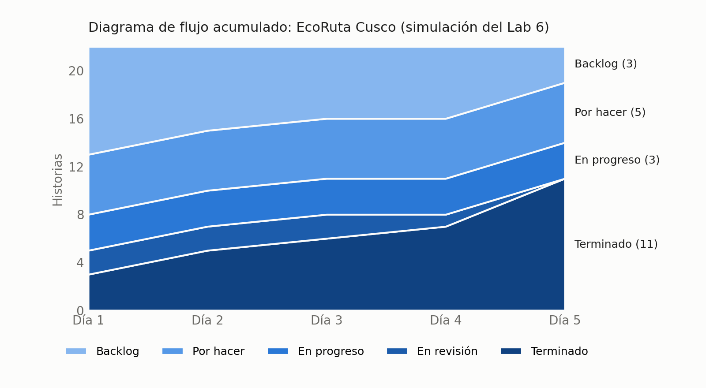
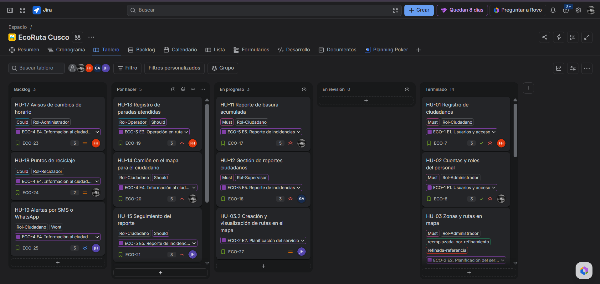

# Laboratorio 6: Gestión del flujo de trabajo con Kanban

**Proyecto:** EcoRuta Cusco: sistema de gestión de recolección de residuos sólidos
**Integrantes:** Flavio Antony Cabeza Huillca, Gisel Dayana Farfan Gomez, Gerald Benjamin Huanto Ayma, Jhon Eber Huayhua Huamani
**Curso:** Ingeniería de Software I

[Tablero Kanban en Jira](https://ing-software1-residuos.atlassian.net/jira/software/projects/ECO/boards/2)

---

## 0. Punto de partida

El tablero se construyó sobre el Product Backlog de EcoRuta Cusco en Jira (espacio **ECO**):

- **Historias:** las 19 del [Laboratorio 3](lab3-historias-usuario.md) y las 6 refinadas en el Laboratorio 5 (HU-03.1 a HU-09.2).
- **Prioridad y estimación:** MoSCoW del Lab 3 y story points acordados en el Planning Poker del Lab 5.
- **Equipo:** Gisel, Flavio, Jhon y Gerald.

| Herramienta | Uso |
|---|---|
| Jira Software | Tablero Kanban del espacio ECO (tablero sin sprints) |

---

## 1. Diseño del tablero

### 1.1 Columnas y políticas explícitas

Cada columna tiene una regla clara de entrada y de salida. Así todo el equipo sabe cuándo puede mover una tarjeta:

| Columna | Qué significa | Una tarjeta entra cuando... | Sale cuando... | Límite WIP |
|---|---|---|---|---|
| **Backlog** | Historias identificadas pero aún no comprometidas | Se registra la historia | Se prioriza, tiene criterios de aceptación y story points, y hay espacio en "Por hacer" | Sin límite |
| **Por hacer** | Próximas historias, listas para empezar (punto de compromiso) | Pasa la reposición semanal | Un integrante la toma y empieza a trabajar | **5** |
| **En progreso** | El responsable está desarrollando la historia | Hay espacio en la columna | Cumple sus criterios de aceptación y se pide revisión | **3** |
| **En revisión** | Otro integrante revisa la historia contra sus criterios de aceptación | El responsable termina | Se aprueba (pasa a Terminado) o se devuelve con observaciones (vuelve a En progreso) | **2** |
| **Terminado** | La historia cumple todos sus criterios y fue revisada | Se aprueba la revisión | — | Sin límite |

**Reglas del equipo:**
- Las tarjetas se mueven de izquierda a derecha, **una columna a la vez**. Solo se puede volver de "En revisión" a "En progreso".
- Nadie revisa su propia historia.
- Si una columna está en su límite, **no se empieza trabajo nuevo**: el equipo ayuda a terminar lo que ya está empezado ("deja de empezar, empieza a terminar").

### 1.2 Por qué esos límites WIP

| Columna | Límite | Justificación |
|---|---|---|
| Por hacer | 5 | Alcanza para una semana de trabajo. Mantiene la cola corta para que la prioridad se pueda cambiar sin desperdiciar análisis |
| En progreso | 3 | El equipo tiene 4 personas. Con un máximo de 3 historias en desarrollo, siempre queda al menos una persona libre para revisar |
| En revisión | 2 | La revisión es rápida pero depende de que alguien deje lo suyo. Un límite bajo obliga a revisar pronto y evita que las historias se acumulen "casi terminadas" |

---

## 2. Configuración del flujo

### 2.1 Responsables

Las historias se repartieron por turno entre los cuatro integrantes. Así cada uno tiene una carga parecida y conoce varias épicas:

| Integrante | Historias |
|---|---|
| Gisel | HU-02, HU-06, HU-10, HU-14, HU-18 |
| Flavio | HU-01, HU-05, HU-09.1, HU-09.2, HU-13, HU-17 |
| Jhon | HU-03.1, HU-03.2, HU-07, HU-11, HU-15, HU-19 |
| Gerald | HU-04, HU-08.1, HU-08.2, HU-12, HU-16 |

### 2.2 Ajuste por el refinamiento del Lab 5

En el Lab 5, HU-03, HU-08 y HU-09 se dividieron en dos historias cada una. Al armar el tablero, las historias originales y las refinadas aparecían a la vez, y el mismo trabajo se contaba dos veces. Se resolvió así:

| Historia original | Se reemplaza por | Responsable | Avance heredado |
|---|---|---|---|
| HU-03 (ECO-9) | HU-03.1 (ECO-26) y HU-03.2 (ECO-27) | Jhon | HU-03.1 pasa a "En progreso" |
| HU-08 (ECO-14) | HU-08.1 (ECO-28) y HU-08.2 (ECO-29) | Gerald | HU-08.1 pasa a "En revisión" |
| HU-09 (ECO-15) | HU-09.1 (ECO-30) y HU-09.2 (ECO-31) | Flavio | Ambas quedan en "Por hacer" |

Las historias originales salieron del flujo con la etiqueta `reemplazada-por-refinamiento` y un comentario que indica qué historias las reemplazan.

---

## 3. Simulación de flujo

Se simuló una semana de trabajo de **5 días**. Cada día se movieron las tarjetas según el avance, se respetaron los límites WIP y se anotaron los bloqueos.

- **Día 0** es la configuración inicial del tablero (12/11), cuando algunas historias se colocaron directamente en "En progreso" y "En revisión".
- Cada movimiento quedó registrado en Jira con un comentario "Lab 6 · Día N" en la historia.

### Día 1

**Estado inicial** (configuración del 12/11):

| Por hacer | En progreso (3) | En revisión (2) | Terminado |
|---|---|---|---|
| 14 historias | HU-03, HU-04, HU-05 | **HU-06, HU-07, HU-08 → 3/2** | HU-01, HU-02 |

**Cuello de botella detectado:** "En revisión" tenía **3 historias con límite 2**, y "En progreso" estaba lleno (3/3). Nadie podía empezar trabajo nuevo, pero tampoco se estaba terminando nada: el flujo estaba detenido en la revisión.

**Acciones:**
1. Se aplicó el ajuste por refinamiento (sección 2.2).
2. Gisel no tenía ninguna historia en progreso, así que revisó junto con Jhon la historia más antigua en revisión, **HU-06**, que pasó a **Terminado**. "En revisión" volvió a 2/2.

3. Se creó la columna **Backlog** y se hizo la **primera reposición**. Las 14 historias no comprometidas pasaron a Backlog, y de ahí se tomaron para "Por hacer" las 5 siguientes en orden de prioridad (las *Must* pendientes y las refinadas del flujo de mapas y GPS). Las demás esperan en Backlog.

**Estado al cierre del día:**

| Backlog (9) | Por hacer (5/5) | En progreso (3/3) | En revisión (2/2) | Terminado |
|---|---|---|---|---|
| HU-09.2, HU-12 a HU-19 | HU-03.2, HU-08.2, HU-09.1, HU-10, HU-11 | HU-03.1, HU-04, HU-05 | HU-07, HU-08.1 | HU-01, HU-02, HU-06 |

### Día 2

- **Revisión:** Gisel revisó HU-07 y Flavio revisó HU-08.1. Ambas pasaron a **Terminado**.
- **Desarrollo terminado:** HU-05 (Flavio) y HU-04 (Gerald) pasaron a **En revisión** (2/2).
- **Nuevo trabajo:** se liberaron dos lugares en "En progreso". Gisel tomó HU-10 y Flavio tomó HU-09.1.
- **Reposición:** HU-12 y HU-09.2 pasaron de Backlog a "Por hacer".

| Backlog (7) | Por hacer (5/5) | En progreso (3/3) | En revisión (2/2) | Terminado (5) |
|---|---|---|---|---|
| HU-13 a HU-19 | HU-03.2, HU-08.2, HU-11, HU-12, HU-09.2 | HU-03.1, HU-10, HU-09.1 | HU-05, HU-04 | + HU-07, HU-08.1 |

### Día 3: cuello de botella en revisión

- Gerald revisó HU-05, que pasó a **Terminado**.
- Jhon terminó HU-03.1 y la pasó a revisión. "En revisión" volvió a quedar **lleno (2/2)**.
- **Gisel terminó HU-10, pero no pudo pasarla a revisión** porque la columna estaba en su límite. La historia quedó **detenida en "En progreso"** y se marcó en Jira con un **impedimento** (bandera). Ocupaba un lugar de desarrollo sin que nadie trabajara en ella.
- Gerald tomó HU-08.2. Se repuso HU-13 desde Backlog.

| Backlog (6) | Por hacer (5/5) | En progreso (3/3) | En revisión (2/2) | Terminado (6) |
|---|---|---|---|---|
| HU-14 a HU-19 | HU-03.2, HU-11, HU-12, HU-09.2, HU-13 | **HU-10 ⚑ (esperando revisión)**, HU-09.1, HU-08.2 | HU-04, HU-03.1 | + HU-05 |

**Análisis:** el mismo cuello de botella del Día 1 apareció de nuevo. Los cuatro integrantes priorizaban desarrollar sobre revisar, y el trabajo "casi terminado" se acumulaba. **Subir el límite de revisión no lo resuelve**: solo agranda la cola. Se acordó una regla: **cada día empieza revisando**, antes de tocar trabajo nuevo.

### Día 4: retrabajo

- Aplicando la nueva regla, Gisel revisó HU-04, que pasó a **Terminado**.
- Flavio revisó HU-03.1 y **la devolvió a "En progreso"**: no advertía cuando una zona nueva se superpone con otra (criterio 3 de HU-03). Gisel apoyó a Jhon en pareja para corregirla.
- Con espacio libre en revisión, **HU-10 pasó a "En revisión"** después de un día de espera, y se le quitó el impedimento.

| Backlog (6) | Por hacer (5/5) | En progreso (3/3) | En revisión (1/2) | Terminado (7) |
|---|---|---|---|---|
| HU-14 a HU-19 | HU-03.2, HU-11, HU-12, HU-09.2, HU-13 | HU-09.1, HU-08.2, HU-03.1 (retrabajo) | HU-10 | + HU-04 |

### Día 5: el flujo se normaliza

- Gerald revisó HU-10 (**Terminado**). HU-03.1, ya corregida, volvió a revisión y Flavio la aprobó (**Terminado**).
- HU-09.1 (Flavio) y HU-08.2 (Gerald) terminaron, se revisaron en el día (por Jhon y por Gisel) y pasaron a **Terminado**.
- **Sistema de arrastre (pull):** con "En progreso" vacío, cada integrante tomó la siguiente historia de "Por hacer". Jhon tomó HU-03.2, Gerald tomó HU-12 y Gisel, que estaba libre, **tomó HU-11** aunque originalmente era de Jhon. En Kanban el trabajo lo toma quien tiene capacidad.
- **Reposición semanal:** HU-14, HU-15 y HU-16 pasaron a "Por hacer".

| Backlog (3) | Por hacer (5/5) | En progreso (3/3) | En revisión (0/2) | Terminado (11) |
|---|---|---|---|---|
| HU-17, HU-18, HU-19 | HU-09.2, HU-13, HU-14, HU-15, HU-16 | HU-03.2, HU-11, HU-12 | — | + HU-10, HU-03.1, HU-09.1, HU-08.2 |

En los cinco días **nunca se superó un límite WIP**: cuando una columna estaba llena, la tarjeta esperaba y el equipo ayudaba a liberar espacio.

---

## 4. Métricas

**Definiciones:**
- **Lead time:** tiempo desde que una historia entra a **"Por hacer"** (el equipo se compromete a hacerla) hasta que llega a **"Terminado"**. Es lo que percibe el cliente.
- **Cycle time:** tiempo desde que una historia entra a **"En progreso"** hasta que llega a **"Terminado"**. Mide cuánto tarda el equipo en hacerla.
- **Throughput:** historias terminadas por día.

Los tiempos se miden en días de trabajo: una historia que entra el Día 2 y termina el Día 5 tiene 3 días.

### 4.1 Lead time y cycle time por historia

| Historia | Entra a Por hacer | Entra a En progreso | Terminado | Lead time | Cycle time |
|---|---|---|---|---|---|
| HU-06 | antes del Día 0 | Día 0 | Día 1 | — | 1 |
| HU-07 | antes del Día 0 | Día 0 | Día 2 | — | 2 |
| HU-08.1 | antes del Día 0 | Día 0 | Día 2 | — | 2 |
| HU-05 | antes del Día 0 | Día 0 | Día 3 | — | 3 |
| HU-04 | antes del Día 0 | Día 0 | Día 4 | — | 4 |
| HU-03.1 | antes del Día 0 | Día 0 | Día 5 | — | 5 |
| HU-10 | Día 1 | Día 2 | Día 5 | 4 | 3 |
| HU-09.1 | Día 1 | Día 2 | Día 5 | 4 | 3 |
| HU-08.2 | Día 1 | Día 3 | Día 5 | 4 | 2 |
| **Promedio** | | | | **4,0 días** | **2,8 días** |

El lead time solo se puede calcular para las historias que entraron a "Por hacer" durante la semana. Las demás ya estaban comprometidas antes de crear la columna Backlog.

### 4.2 Throughput y WIP

| | Día 1 | Día 2 | Día 3 | Día 4 | Día 5 | Total / promedio |
|---|---|---|---|---|---|---|
| Historias terminadas (throughput) | 1 | 2 | 1 | 1 | 4 | **9 historias, 1,8 por día** |
| Trabajo en curso (En progreso + En revisión) | 5 | 5 | 5 | 4 | 3 | **4,4 historias** |

**Comprobación con la Ley de Little** (cycle time promedio ≈ WIP promedio ÷ throughput): 4,4 ÷ 1,8 ≈ **2,4 días**. Es cercano al cycle time medido (2,8 días), lo que confirma que los datos registrados son coherentes.

### 4.3 Diagrama de flujo acumulado

Cómo leerlo: el grosor de cada banda es la cantidad de historias en esa columna.
- La banda de **Terminado** crece poco del Día 1 al Día 4 y salta el Día 5: el equipo terminaba lento mientras la revisión estaba atascada.
- La banda de **En revisión** se mantiene llena (2) los Días 1 a 3: ese es el cuello de botella. Se adelgaza cuando el equipo empieza a revisar primero (Días 4 y 5).
- **Por hacer** y **En progreso** tienen grosor constante (5 y 3) porque los límites WIP las mantienen estables.

### 4.4 Cuellos de botella detectados

| # | Cuello de botella | Evidencia | Acción tomada |
|---|---|---|---|
| 1 | **Revisión** (Días 1 y 3) | "En revisión" superó su límite (3/2) el Día 1; el Día 3, HU-10 esperó un día completo sin poder pasar a revisión | Regla "cada día empieza revisando"; quien no tiene trabajo en progreso revisa |
| 2 | **Retrabajo** (Día 4) | HU-03.1 volvió de revisión a "En progreso" por un criterio de aceptación no cumplido; su cycle time fue el más alto (5 días) | Trabajo en pareja para corregirla; revisar los criterios de aceptación **antes** de empezar a programar |
| 3 | **Historias duplicadas** (inicio) | HU-03, HU-08 y HU-09 aparecían junto con sus refinadas | Las originales salieron del flujo (sección 2.2) |

---

## 5. Entregable

### 5.1 Tablero Kanban activo

### 5.2 Historias distribuidas correctamente

Las 22 historias en flujo quedaron así al cierre del Día 5:

| Columna | Historias | Límite WIP | ¿Cumple? |
|---|---|---|---|
| Backlog | 3 | — | ✓ |
| Por hacer | 5 | 5 | ✓ |
| En progreso | 3 | 3 | ✓ |
| En revisión | 0 | 2 | ✓ |
| Terminado | 11 | — | ✓ |

Cada historia tiene un responsable, y ninguna columna supera su límite.

## 6. Trabajo extra: tablero actualizado durante la semana

- El tablero se actualizó **cada día de la semana** (secciones 3 y 4). Quedó registro en Jira, con un comentario por movimiento, y en el diagrama de flujo acumulado.
- Después de la entrega, el tablero queda **activo** con trabajo en "En progreso" y "Por hacer". El equipo lo seguirá actualizando con el mismo procedimiento: revisar primero, respetar los límites WIP y reponer "Por hacer" desde Backlog una vez por semana.

---

## 7. Conclusiones

1. **Los límites WIP hacen visibles los problemas.** Sin límites, las historias del Día 1 se habrían seguido acumulando en revisión sin que nadie lo notara. Con el límite, el tablero mostró el atasco de inmediato.
2. **El cuello de botella del equipo es la revisión, no el desarrollo.** Apareció dos veces (Días 1 y 3). La solución fue un cambio de hábito ("revisar antes de empezar") y no subir el límite.
3. **Terminar es más valioso que empezar.** El Día 5, con la revisión al día, el equipo terminó 4 historias, tantas como en los cuatro días anteriores juntos.
4. **Los criterios de aceptación evitan retrabajo.** La única historia devuelta (HU-03.1) falló un criterio que ya estaba escrito desde el Lab 3. Revisarlos antes de programar habría ahorrado 2 días.
5. **Las métricas son coherentes entre sí.** Con un cycle time promedio de 2,8 días, un lead time de 4 días y un throughput de 1,8 historias por día, la Ley de Little da un resultado cercano. Estos valores sirven como referencia para prever cuándo se terminarán las historias pendientes.
